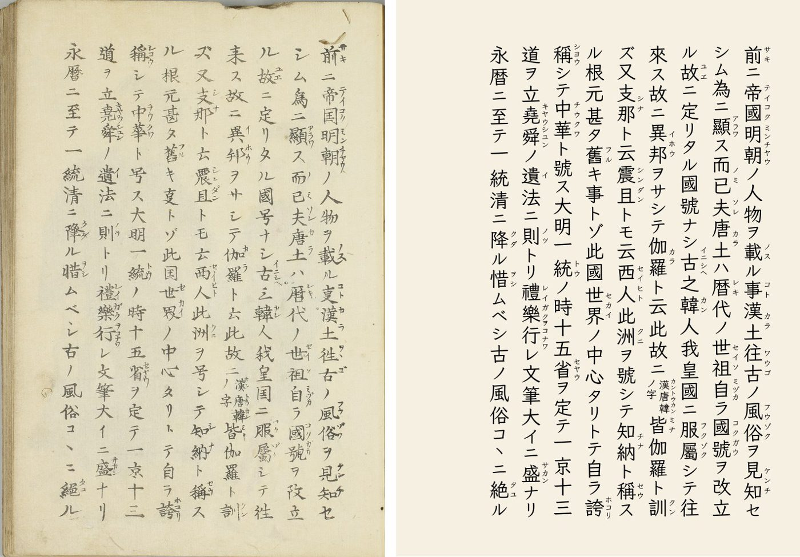
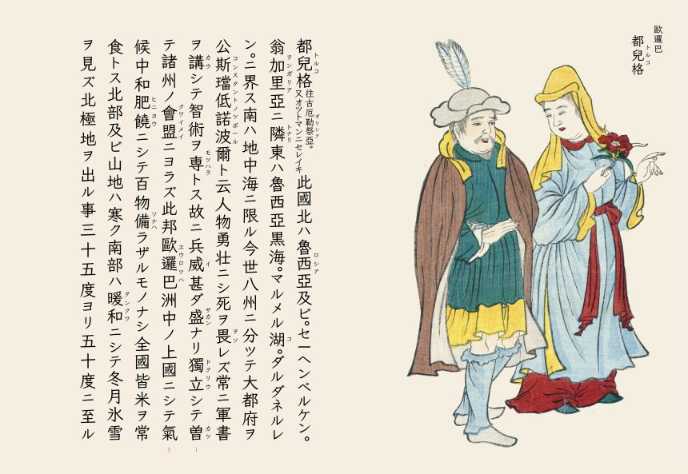
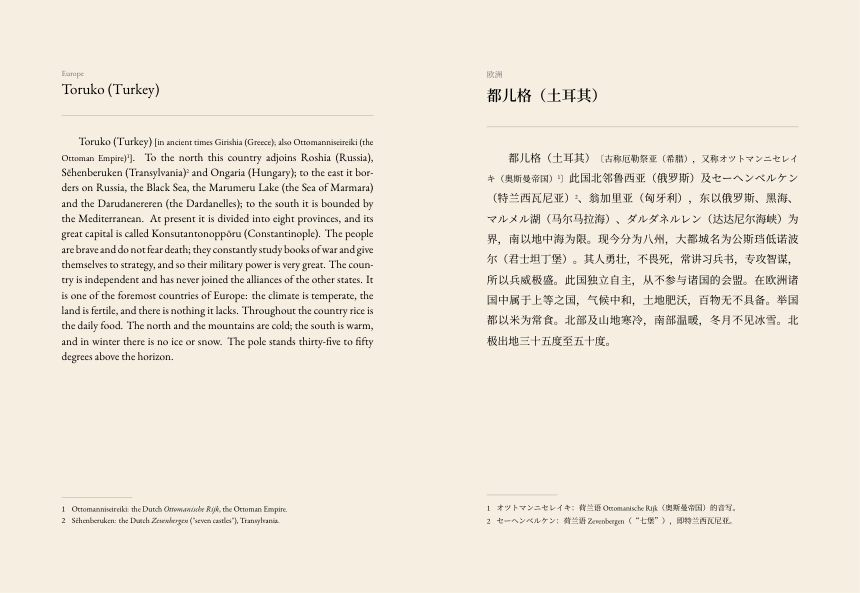

# 外蕃容貌圖画 重排本・中英対訳本

田川春道撰・倉田東岳画『外蕃容貌圖画』（安政二年〔1855〕正月刊，乾坤二冊，製本売捌 金華堂須原屋佐助）の
**仿刻重排本**と，原文に中国語訳・英訳を添えた**三言語本**。底本は筑波大学附属図書館所蔵本（ヤ600-4）。

田川春道《外蕃容貌图画》（1855）的仿刻重排本，以及附中文、英文译文的三语本。

A re-typeset edition of *Gaiban yōbō zuga* (*Illustrated Appearances of Foreign Peoples*, Edo 1855, two
volumes): portraits of the peoples of some fifty countries with short descriptions, set vertically page
for page like the original, and a trilingual edition with Chinese and English translations.

## 原本と重排

左は原本（筑波大学附属図書館デジタルコレクション），右は本版の同じ頁（乾・大明）。



三言語本では各国が二開：原本どおりの図と本文の一開に，訳文の一開（右に中国語，左に英語）が続く（坤・都兒格）。

| 原本の一開 | 訳文の一開 |
|---|---|
|  |  |

## PDF（Releases）

冊ごとに二種：**対開本** `_spread`（一頁が原本の見開き一つ，画面で読む用）と**単頁本** `_single`（一頁が半丁，印刷用）。

| 版 | 乾（序・亜細亜・欧羅巴前半） | 坤（欧羅巴後半・亜弗利加・南北亜墨利加） |
|---|---|---|
| 仿刻重排本（原文のみ） | `gaiban-yobo_qian_{spread,single}.pdf` | `gaiban-yobo_kun_{spread,single}.pdf` |
| 三言語本（原文・中文・English） | `gaiban-yobo_qian_zh-en_{spread,single}.pdf` | `gaiban-yobo_kun_zh-en_{spread,single}.pdf` |

各冊に書衣，凡例，異体字一覧，校記（本文の該当箇所と双方向にリンク），乾は序の釈文を付す。

## 底本と方針

- **縦組・仿刻**：一頁＝原本の半丁，列の切れ目・振り仮名・割注・圏点を原本どおりに組む。本文は手書き版下に近い
  Klee One，序（行草）は衡山毛筆フォント行書。
- **字形**：異体字・略字は通行の旧字体に統一し（対照表は巻末），原本の誤字は改めず校記に記す。
- **図版**：紙の黄ばみと照明むらを除き，手彩色と線はそのまま（AI による補筆なし）。図上の国名・世界図の傍書は
  画像から除いて文字で組み直した。
- **翻字と校正**：KuroNet（人文学オープンデータ共同利用センター）の自動翻刻と照合，振り仮名784箇所と疑問箇所は
  すべて原本画像と照合，最後に編者が校記を原本で通読した。疑問箇所は京都大学文学研究科所蔵の同版本（地理:J6/2）とも対校した。本文の多くは箕作省吾『坤輿圖識』（1845）と杉田成卿閲『地學正宗』（1851）に拠る（四至・都府など）。
- **訳文**（三言語本）：中国語は現代語・簡体字，英語は原文に忠実で読みやすい訳，注は簡潔。専名は各頁の初出で
  原本の表記（英語は振り仮名のローマ字）に今名を括弧で添える。訳文規程と地名表は `work/translation/`。

翻字・組版・翻訳は Claude（Anthropic の AI）の支援による。中国語訳・英訳は Claude が訳し別の Claude が校閲したもので，
**専門家の校閲を経ていない**。誤りの指摘を歓迎する（Issues）。

## 作り方

```
python -I tools/fetch_iiif.py scans/tsukuba     # 底本画像（約 4 GB）
python -I tools/make_plates.py                  # 図版（figures/README.md 参照）
python -I tools/make_covers.py
python -I tools/build.py [qian|kun] [single|spread]        # 仿刻重排本
python -I tools/build.py [qian|kun] [single|spread] tri    # 三言語本
```

XeLaTeX（TeX Live 2022 で確認）と Python 3（PyYAML, Pillow, NumPy, SciPy, fontTools）が必要。フォントは同梱しない：
`fonts/` に Klee One SemiBold，衡山毛筆フォント行書（opentype.jp），BIZ UDMincho，全字庫正楷体・正宋体
（TW-Kai/TW-Sung と ExtB），Noto Serif SC（Regular, SemiBold）を置く。EB Garamond は TeX Live のもの。

| ディレクトリ | 内容 |
|---|---|
| `text/qian`, `text/kun` | 翻字：一ファイル一半丁，一行一列（`漢字《よみ》`，`〔右\|左〕` 割注） |
| `text/layout.yaml`, `labels.yaml`, `variants.tsv`, `jiaoji.yaml` | 頁の配置，図上の国名，異体字表，校記 |
| `text/tr/` | 訳文（一頁一ファイル，中文・英文と注） |
| `tools/` | 生成・検査スクリプト（`gen_pages.py` 本文，`gen_trans.py` 訳文頁，`gen_appendix.py` 付録） |
| `work/translation/`, `work/review/` | 訳文規程・地名表，校閲記録 |

## 権利

- **図版**（PDF 中の人物図・世界図・印影）は筑波大学附属図書館デジタルコンテンツ（No Copyright – Contractual
  Restrictions）を改変したもので，同館の利用条件（調査・研究・教育・学習目的に限る，出典の明示，改変の明示）に従う。
  画像そのものはこのリポジトリに含めない。
- **翻字・校記・訳文・組版**：CC BY 4.0（`LICENSE`）。**スクリプト**：MIT（`LICENSE-MIT`）。原本の本文はパブリック
  ドメイン。
